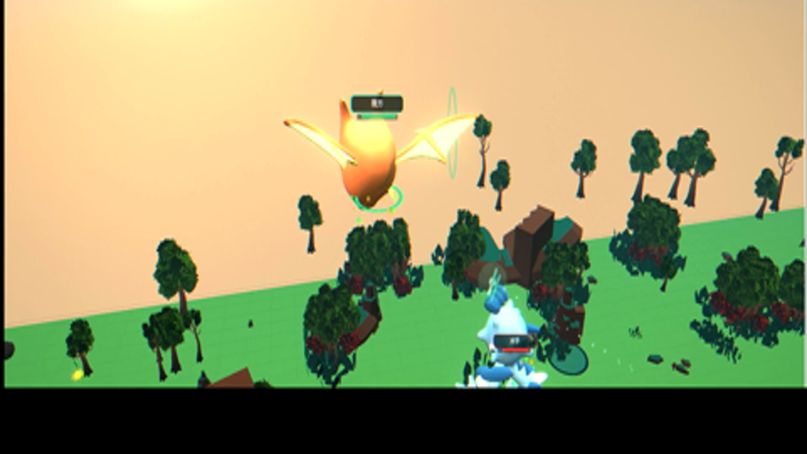
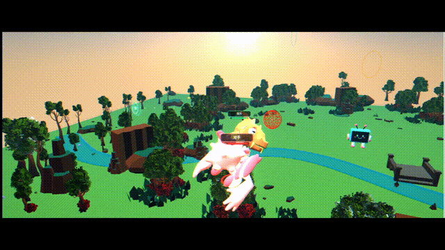

# 灵境伙伴 · 数字果蝇 (Digital Fly Lab)

一个把**真实果蝇连接组数据**接进 3D 战斗游戏里的网页原型：你操控一只数字精灵，它的行为由一套**果蝇大脑连接组脉冲神经网络**驱动，对手也一样。



---

## 这是什么

- **生物学内核**：内置 `FruitFly Connectome`（FAFB / hemibrain 风格连接组）的网络层，按神经元群 + 突触权重模拟脉冲发放，形成"本能—情绪—决策"三层驱动。
- **游戏外壳**：Three.js 实时 3D 场景，60+ 精灵模型、元素属性、技能系统、战斗结算，全部跑在浏览器里。
- **可视化**：右侧面板实时显示神经元放电、脑区活跃度、决策链路，能看见"它为什么这么做"。

## 玩法

1. 打开页面 → 选一只精灵（火 / 水 / 风 / 土等属性）
2. 进入 `对战` → 开始练习 → 观察对手的招式节奏
3. 右侧 `大脑` 页签可以看到此刻是哪些神经群在放电

## 本地运行

需要 Node.js 18+。

```bash
cd app
npm install
npm run dev      # 打开 http://127.0.0.1:5173
```

生产构建：

```bash
npm run build
npm run preview
```

## 技术栈

| 层 | 技术 |
|---|---|
| 渲染 | Three.js 0.180（实时 PBR + 阴影 + 后处理） |
| 构建 | Vite 7 |
| 大脑 | 自研脉冲神经网络（`src/brain.js`），连接组数据在 `public/data` |
| 测试 | node:test + Playwright 冒烟测试 |

## 项目结构

```
app/
  src/
    main.js              # 主循环、渲染、UI 绑定
    brain.js             # 连接组脉冲神经网络
    biology.js           # 生物学参数
    collection.js        # 精灵收集与成长
    biped-gait.js        # 双足步态
    camera-interaction.js# 相机交互
  public/
    models/              # 精灵 / 场景 glb 模型
    data/                # 连接组数据
    mediapipe/           # 姿态识别模型
  tests/                 # 冒烟测试
```

## 效果演示



完整演示（58 秒）：[`docs/preview.mp4`](docs/preview.mp4)（9.5 MB，1280×720）

## 项目亮点

- 中央竞技场留空、四周密林成簇的分区地图布局（程序化铺装，686+ 场景物件）
- 程序化天空：三段渐变 + 太阳圆盘 + FBM 云层，并用 PMREM 烘成环境贴图驱动 PBR 材质
- 技能特效增强层：地面冲击波圆环 + 火花粒子，自动继承技能配色
- 无 UV 模型的鳞片 / 羽毛纹理采用三平面投影（triplanar）注入着色器

## 说明

这是一个**科普 + 游戏原型**项目，连接组数据用于驱动行为决策，不代表真实果蝇神经科学的完整复现。

## License

MIT（模型资源来自 kenney / quaternius，遵循各自原始许可，见 `app/public/models/*/ATTRIBUTION.md`）